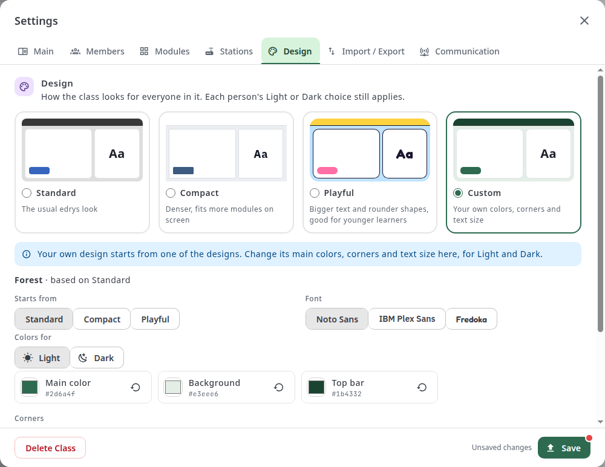

# edrys-lite Blog

The source of the [edrys-lite blog](https://edrys-labs.github.io/blog/): news, new modules, remote labs and events around [edrys-lite](https://edrys-labs.github.io).

The site is built with [Hugo](https://gohugo.io) (extended edition) and the `itheme` theme, which is kept in [themes/itheme](themes/itheme).

## Run It Locally

```bash
hugo server
```

Then open http://localhost:1313/blog/. Add `-D` to also show posts marked `draft: true`.

## Write a Post

Posts live in [content/posts](content/posts) and are numbered in order, for example `033_class-designs.md`. Start each one with this front matter:

```yaml
---
title: "Class Designs: Give Every edrys-lite Classroom Its Own Look"
date: 2026-11-19T10:00:00+01:00
description: "One or two sentences, shown in the post list and when the post is shared."
draft: false
author: "Your Name"
cover: 'static/img/posts/class-designs/cover.png'
---
```

Without a `cover`, the post uses [content/static/img/social-card.png](content/static/img/social-card.png).

### Images

Put a post's images in `content/static/img/posts/<post-name>/`. The `cover` path is relative to `content/`, as shown above. Inside a post, link images by their full GitHub URL, so they show up both on the site and on GitHub:

```html
<div style="text-align: center;">
  
</div>
```

### Videos and Galleries

Two shortcodes are in [layouts/shortcodes](layouts/shortcodes):

```markdown



```

`youtube` takes the video ID and embeds it through youtube-nocookie.com. `image-gallery` shows every image in a folder under [assets](assets) as a grid that opens in a lightbox.

## Publish

Every push to `main` builds the site with `hugo --minify` and publishes it to the `gh-pages` branch ([.github/workflows/deploy.yaml](.github/workflows/deploy.yaml)). The `public/` folder is build output and is not committed.

## Layout

| Path | Contents |
| ---- | -------- |
| [hugo.toml](hugo.toml) | site title, base URL, social links and blogroll |
| [content/posts](content/posts) | blog posts |
| [content/about.md](content/about.md), [showcase.md](content/showcase.md), [imprint.md](content/imprint.md) | other pages |
| [content/static/img](content/static/img) | post covers and images |
| [assets](assets) | images for `image-gallery`, extra CSS |
| [static](static) | files copied as they are, such as the favicon |
| [layouts](layouts) | overrides of the theme: the page head and the shortcodes |
| [themes/itheme](themes/itheme) | the theme |

## License

Public domain, see [LICENSE](LICENSE).
