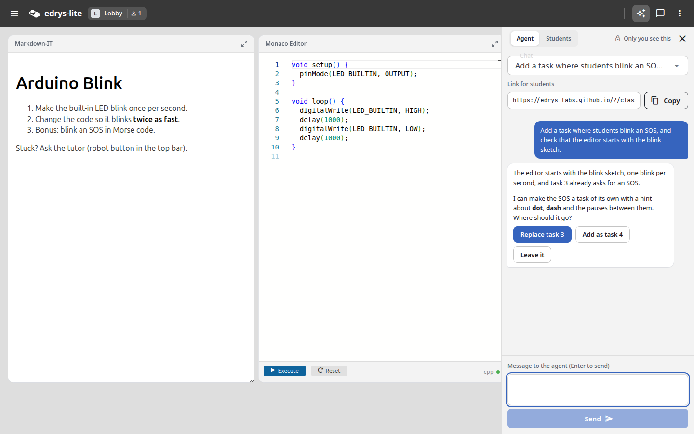
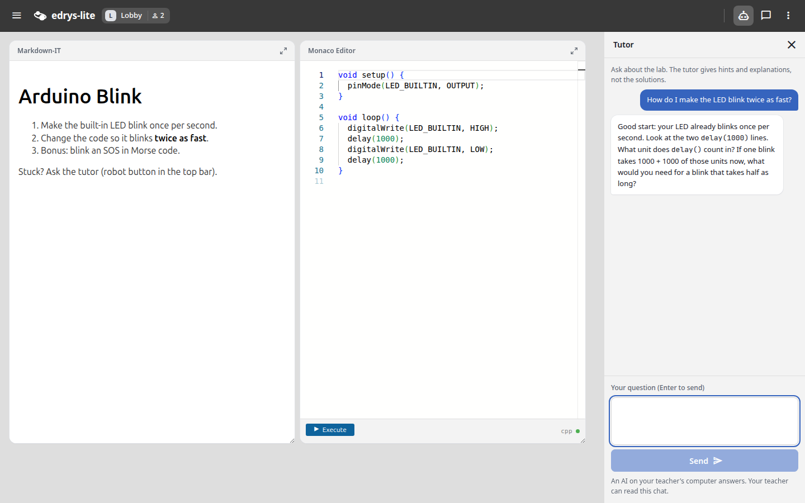
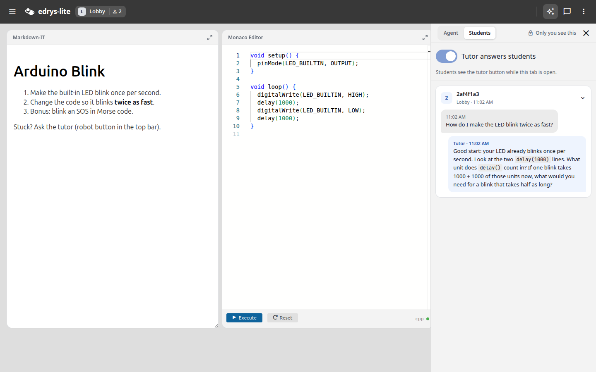

Our [Agent Skills](/blog/posts/030_agent-skills/) taught AI assistants how Edrys-lite works, but an assistant working only on a file can't see whether the classroom accepted the lab, and it can't help the students once class begins.

[**edrys-dev**](https://github.com/edrys-labs/edrys-devserver), our local development server for labs, closes both gaps. You write your lab in a `lab.yml` file, edrys-dev opens it as a class in your browser, and every save updates all open tabs. On top of that, it now offers two agents with very different jobs:

| Agent | Who talks to it | What it can do |
|-------|-----------------|----------------|
| **Teacher agent** | You, while you build the lab | Edit `lab.yml` and your modules, look into the running class |
| **Tutor agent** | Your students, while they work | Answer questions, and nothing else |

## The Teacher Agent: Build the Lab From Inside the Class

The teacher agent is the AI coding agent you already use, such as **Claude Code** or **GitHub Copilot**, connected to edrys-dev over [MCP](https://modelcontextprotocol.io). To set up a new lab:

```bash
npx @edryslabs/edrys-dev init my-lab
```

Open the new folder in your agent and write "start". The agent launches edrys-dev itself. A **sparkles button** in the top bar of the class then opens the agent chat, which only you can see. Write what you want, and the agent edits the lab while the class updates next to the conversation.

<div style="text-align: center;">
  
</div>

The agent can also check its own work in the live class. It sees the rooms, users and modules, reads the messages between modules and the errors from your own modules, and can open a student or station tab. An editor whose **Execute** button reaches nobody can now be traced by reading the messages that were actually sent, rather than by guessing from the configuration.

## The Tutor Agent: Help for Students During the Lab

Start edrys-dev with `--tutor`, and your students get a **robot button** in the top bar. They need nothing but the class link. The answers come from an AI on your computer: Claude Code by default, or Codex with `--tutor-agent codex`.

<div style="text-align: center;">
  
</div>

The tutor gives hints instead of whole solutions, in the student's language. With every question it reads the current `lab.yml` and what the modules in the student's room share, such as the code in an editor. It can't see terminal output or the screen, so it asks students to paste those.

You can steer it with a `tutor.md` file next to `lab.yml`, for example *"Task 2 is about the delay() values, don't give the numbers."* Students don't receive this file, but a determined student may get the tutor to repeat it, so keep real secrets out of it.

### An Agent That Can Only Answer

Students are writing into a program on your computer, so that program must not be able to do anything except reply. The tutor is therefore separate from the teacher agent: each question starts its own process with no tools, no MCP servers and none of your settings, in an empty folder. A student can't reach your files, your shell or the agent that edits your lab. Codex has no single "no tools" switch, so edrys-dev turns off each of its tools and drops any answer for which it used one anyway.

Questions and answers are encrypted between the student's browser and your tab, and students are told that an AI answers and that you can read the chat.

### Limits and Cost

Each student can ask up to 20 questions an hour, and the whole class up to 200 (`--tutor-per-hour` changes it), so nobody can use up your account by rejoining under new names.

Every question uses the account the agent is signed in to. Answering students with a personal plan (Claude Pro/Max, ChatGPT) may break its terms, so for a class, use an API key. Only the tutor uses it, not your own agent:

```bash
ANTHROPIC_API_KEY=sk-ant-... npx @edryslabs/edrys-dev lab.yml --tutor --tutor-model haiku
```

## How the Two Work Together

The agent chat has a **Students view** showing every question and answer as it happens, with a switch to turn the tutor off and on without restarting.

<div style="text-align: center;">
  
</div>

After class, the teacher agent can read those conversations too:

> *Where did students get stuck today? Improve the instructions for those tasks and update tutor.md.*

The next group starts with a clearer lab and a better-prepared tutor.

## Try It

```bash
npx @edryslabs/edrys-dev init my-lab --tutor
```

You need [Node.js](https://nodejs.org) 20 or newer, and Claude Code or Codex on your computer for the tutor. When edrys-dev starts, it prints a link for your students. Keep your `/?dev` tab open while they work, since they get the class and the tutor through it.

Both agents can make mistakes. Try the lab with a second browser as a student before you use it, read any code the agent wrote before running it at a station, and watch the Students view during the first sessions.

edrys-dev is open source: [edrys-labs/edrys-devserver](https://github.com/edrys-labs/edrys-devserver). Learn more about Edrys-lite: [edrys-labs.github.io](https://edrys-labs.github.io)
