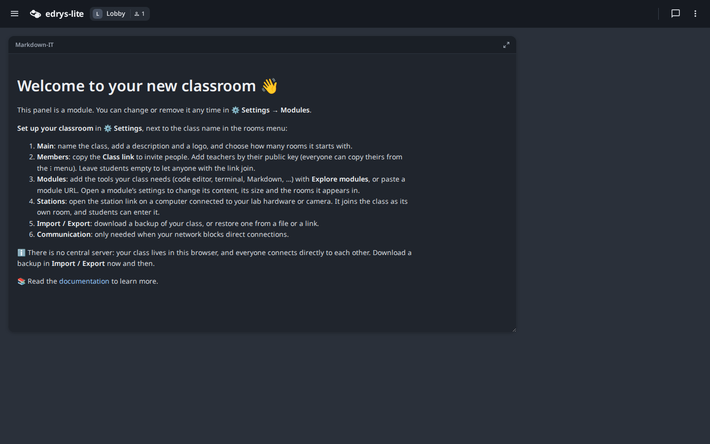
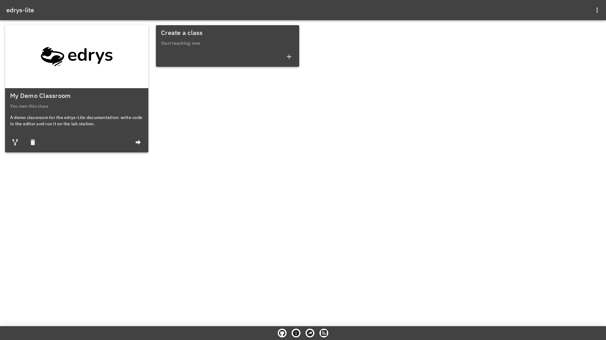
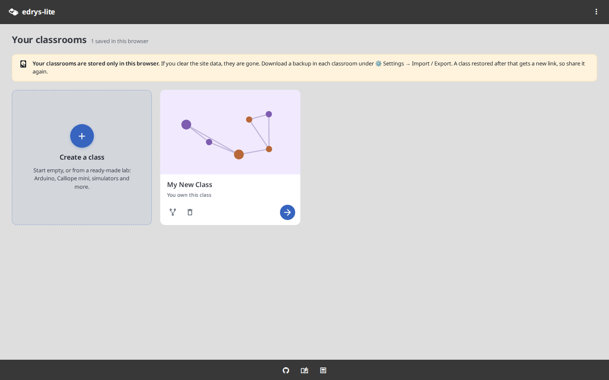
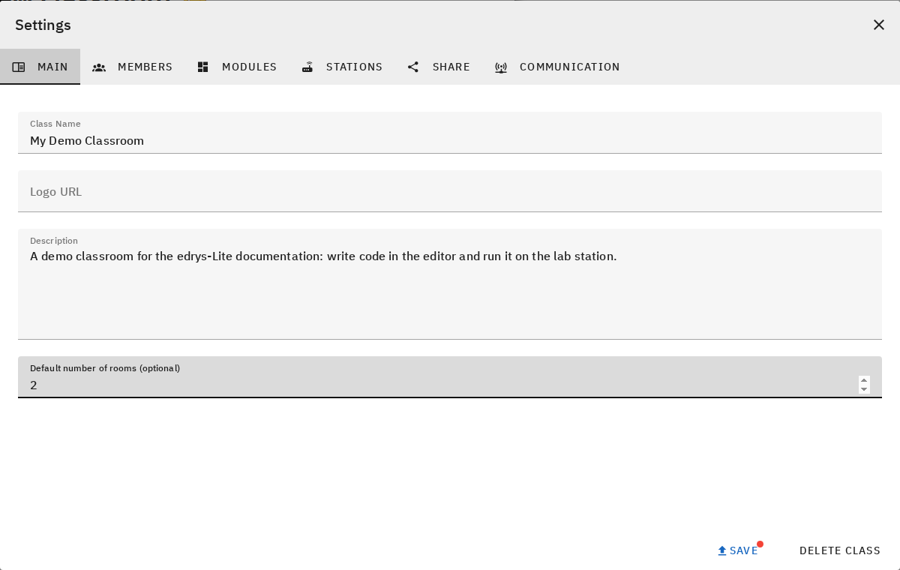
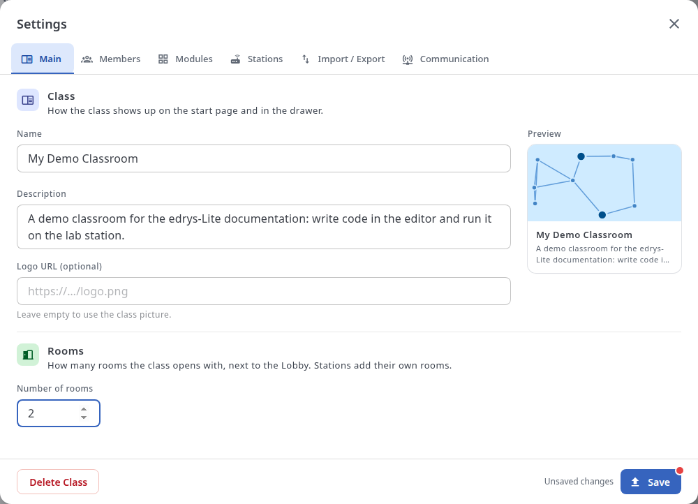
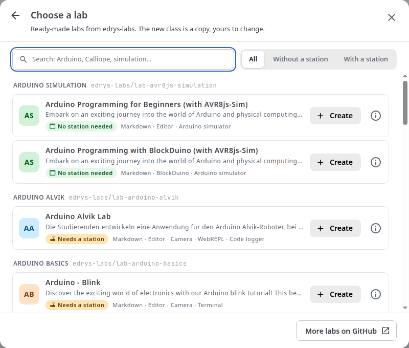
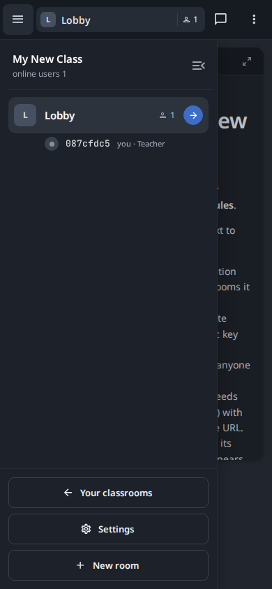

A lab in Edrys-lite is built from many pieces: rooms, modules from different authors, stations, a settings dialog with a lot to configure. Over time, the interface around those pieces had started to feel dated and uneven, and it was never designed for a phone.

Edrys-lite 3.2 changes that with a full redesign. The way classes work stays the same, and your existing classrooms carry over. What's new is how everything looks and how easy it is to find your way around.

## Light, Dark or System

The three-dot menu in the top right now has a theme switch: **Light**, **Dark**, or **System** to follow your device. The whole interface follows it, from the top bar and rooms drawer to the chat, the settings and the module frames.

<div style="text-align: center;">
  
</div>

The fonts are new as well: Noto Sans for text and JetBrains Mono for code.

## Your Classrooms

The start page used to be a plain row of dark cards. Now a dashed **Create a class** card sits first and tells you that you can start empty or from a ready-made lab. A class without a logo gets its own generated picture, so classes are easier to tell apart at a glance. A notice also makes it clear that your classrooms are stored only in this browser, and that you should keep a backup.

<div style="display: flex; flex-wrap: wrap; gap: 12px; justify-content: center; max-width: 1000px; margin: 0 auto;">
  
  
</div>

## Settings

Settings is where teachers spend most of their time, so it changed the most. Each section now has a heading with a coloured icon and a sentence explaining what it's for. Labels sit above the fields, the selected tab is clearly marked, and station setup is broken into numbered steps. On the Main tab, a live preview shows how your class will appear on the start page.

<div style="display: flex; flex-wrap: wrap; gap: 12px; justify-content: center; max-width: 1000px; margin: 0 auto;">
  
  
</div>

Rooms have their own colours too, so a room's tile in the drawer and its modules in Settings can be matched at a glance.

### Find a Ready-Made Lab

You no longer have to start from nothing or hunt for a lab file on GitHub. A new labs dialog lists the ready-made labs from edrys-labs, for Arduino, Calliope mini, simulators and more. You can search by board or topic, and show only labs with or without a station. A tag on each lab tells you whether it needs hardware at a station or runs with nothing but a browser.

<div style="text-align: center;">
  
</div>

There are two ways to open it. When you create a class, choose **From a ready-made lab** and click **Create** next to a lab to get your own copy. In an existing class, go to **Settings → Import / Export** and click **Browse labs**. Using a lab there replaces the setup of that class after you confirm, while its members stay.

## On a Phone

The classroom list, top bar, rooms drawer, chat and modules all have a phone layout now, with buttons large enough to tap. Settings adapts too, including in Arabic, where the layout runs right to left while URLs, keys and code stay left to right.

<div style="text-align: center;">
  
</div>

## Modules That Match the Classroom

A lab is only as consistent as its modules, and those are separate web pages, often by different authors. So the theme now reaches them too. Module authors get the classroom's look by adding one shared stylesheet:

```html
<script src="https://edrys-labs.github.io/module/edrys.js"></script>
<link rel="stylesheet" href="https://edrys-labs.github.io/module/vendor/water.min.css" />
<link rel="stylesheet" href="https://edrys-labs.github.io/module/edrys-module.css" />
```

CSS built on the `--edrys-*` colour variables then switches with the theme by itself. Code that sets colours in JavaScript, like an editor theme or a chart, can read `Edrys.theme` and listen with `Edrys.onTheme`:

```javascript
const stop = Edrys.onTheme?.((theme) => {
  // "light" or "dark": rebuild your editor or chart colours here
});
```

Modules that don't use the stylesheet keep working and keep their own look. The [documentation](https://github.com/edrys-labs/documentation) has the full list of variables and layout parts, and the `edrys-module` [Agent Skill](/blog/posts/030_agent-skills/) knows them too, so a module written with an AI assistant comes out in the same style.

## Try It

The new design is live at [edrys-labs.github.io](https://edrys-labs.github.io). Open a class and pick a theme from the three-dot menu.

If something looks wrong, on a particular screen, language or module, please [open an issue](https://github.com/edrys-labs/edrys-lite/issues).
