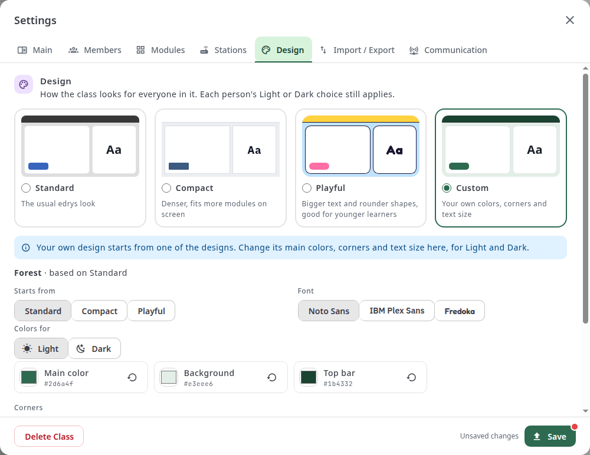

The [new look](/blog/posts/032_new-design/) in Edrys-lite 3.2 gave every classroom light and dark themes. But one look doesn't suit every class. A lab with eight modules needs every pixel, while a class of ten-year-olds needs big buttons and some colour. And a university course might want its own colours.

Edrys-lite 3.3 adds **class designs**. A teacher picks how the classroom looks, and everyone in the class sees it.

## Pick a Design

Settings has a new **Design** tab. It offers three built-in designs, each shown as a small preview in its own colours and corners:

| Design       | Looks                                                                                                  |
| ------------ | ------------------------------------------------------------------------------------------------------ |
| **Standard** | the usual Edrys-lite look                                                                              |
| **Compact**  | smaller text, nearly square corners and a white top bar, so more modules fit on screen                 |
| **Playful**  | bigger text, round shapes, a yellow top bar, thick outlines and a colour per module, for younger learners |
| **Custom**   | your own colours, corners and text size, on top of one of the three                                    |

<div style="text-align: center;">
  
</div>

The classroom changes as soon as you click a design, so you can try them all. Everyone else sees it only when you click **Save**.

A few things stay the same whatever you choose:

- Everyone still picks **Light**, **Dark** or **System** for themselves, because every design has a light and a dark half.
- The start page and other pages outside a classroom always use Standard.
- On phones, the top bar and rooms menu keep their sizes so they stay easy to tap.

## Make Your Own

Pick **Custom** and a short form opens below the cards. Choose the design to start from, a font (Noto Sans, IBM Plex Sans or Fredoka), and then the main colour, background and top bar, separately for light and dark. Two sliders change all corners at once, from square to round, and all text at once, from smaller to larger.

You don't need to worry about readable text. Text on the main colour and on the top bar turns black or white, whichever reads better. A reset button next to each colour takes it back to the starting design.

## The Design File

The form covers the main parts. For everything else there is a design file. **Download design file** saves your design as YAML. You can edit it and load it again with **Upload design file**. It holds only what you changed, and anything left out comes from the base design:

```yaml
name: Forest
base: standard
font: noto-sans
shape:
  radius-card: 16px
  radius-control: 10px
sizes:
  bar: 60px
  module-head: 40px
extras:
  title-case: uppercase
light:
  colors:
    primary: '#2d6a4f'
    background: '#e3eee6'
    surface-variant: '#1b4332'
dark:
  colors:
    primary: '#52b788'
    background: '#14241c'
    surface-variant: '#081c15'
```

In the file you can also set every corner, text size and colour by name, and the height of the top bar and the width of the rooms menu and chat. With a Playful base you can also turn its dotted background and hard shadows on or off. The [documentation](https://github.com/edrys-labs/documentation) lists every field.

The design is saved with the class, so it travels with the lab file under `meta`:

```yaml
meta:
  design: custom
  customDesign:
    name: Forest
    base: standard
    light:
      colors:
        primary: '#2d6a4f'
```

So a lab you share on GitHub keeps its look when someone else loads it.

### Values, Not CSS

A design file holds values only, never CSS. Lab files are often loaded from somewhere else without anyone reading them first. CSS could load images from other servers, which would tell those servers who is in the class, or it could hide parts of the classroom. So each browser checks the design before it uses it. It leaves out anything it can't use and keeps the rest. When you upload a file, Settings lists the lines that were left out and says why.

## Modules Follow the Main Colour

A design changes the classroom around the modules, not the modules themselves. There is one exception. Modules that use the shared edrys-labs stylesheet (introduced in [the last post](/blog/posts/032_new-design/)) take the design's main colour for their main buttons. In a Playful class, for example, the editor's **Execute** button and the survey's **Start Survey** button are both pink.

For module authors, `--edrys-primary` and `--edrys-on-primary` now follow the class design. All other variables stay the same in every design. Use `--edrys-primary` only for the main action, as `button.primary` does, and your module will look right whatever colour a teacher picks.

## Try It

Class designs are live in Edrys-lite 3.3 at [edrys-labs.github.io](https://edrys-labs.github.io). Open one of your classes, go to **Settings → Design**, and try them out.

If a design looks wrong with a particular module, screen or language, please [open an issue](https://github.com/edrys-labs/edrys-lite/issues).
